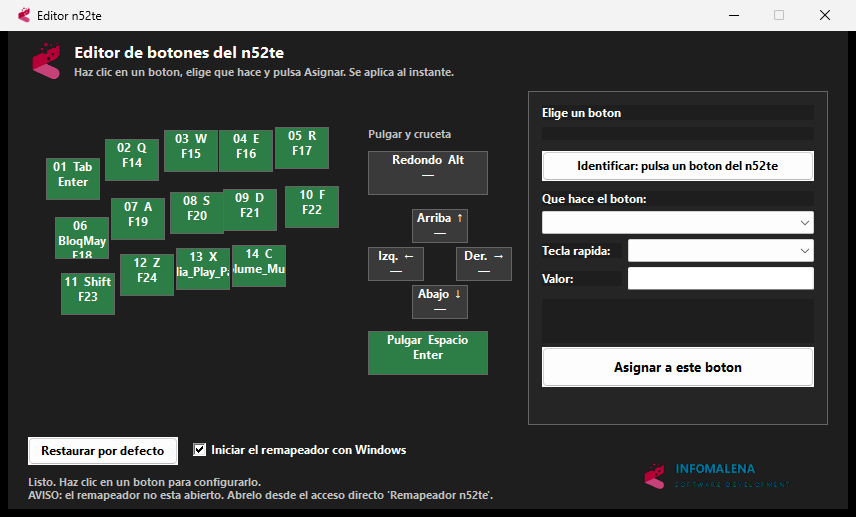
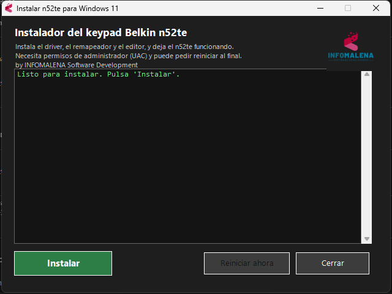

# n52te Windows 11 Driver — Belkin / Razer Nostromo n52te

**Make your Belkin n52te (a.k.a. Razer Nostromo n52te / n52 Tournament Edition) gaming keypad work perfectly on Windows 11 and Windows 10 (64-bit).** The original 2008 Belkin/Razer software no longer works on modern Windows — this project replaces it with a one-click installer, a per-device remapper (your normal keyboard is never touched) and a visual button editor.

> 🇪🇸 **¿Hablas español?** Más abajo tienes la [versión completa en español](#-español).

<p align="center">
  
</p>

---

## ⬇️ Quick download

1. Go to the **[Releases](../../releases/latest)** tab and download **`Instalar-n52te.exe`**.
2. Run it (it will ask for administrator rights).
3. If Windows shows *"Windows protected your PC"* (SmartScreen): click **More info → Run anyway** (normal for free software without a paid code-signing certificate).
4. Follow the steps. Done!

<p align="center">
  
</p>

## 🔒 Verify your download is authentic

This installs a driver, so **only download it from this repository's [official Releases tab](../../releases/latest)** — never from third-party sites, which could ship a modified version with malware.

To make sure the `.exe` you downloaded is exactly ours, check its **SHA-256** fingerprint. Open PowerShell in your Downloads folder and run:

```powershell
Get-FileHash .\Instalar-n52te.exe -Algorithm SHA256
```

The result must match this **exactly** (also published in [`Instalar-n52te.exe.sha256`](Instalar-n52te.exe.sha256)):

```
D599C1256F4A61BBE9E09EC89C7D660EEE047FAA8F4C02CE2F64ABC4E2A7377B
```

If it doesn't match, **don't run it**. You can also upload the file to [VirusTotal](https://www.virustotal.com/) and scan it yourself before running.

## ❓ Why is this needed?

The **Belkin n52te** (and its twin, the **Razer Nostromo n52te**) is a legendary 2008 gaming keypad. The official Belkin/Razer software (`n52te v2.1.2`, July 2008) was built for Windows XP/Vista and **its driver no longer loads on Windows 11** — Core Isolation / Memory Integrity (HVCI) blocks kernel drivers that old — so the original profile editor shows *"n52te not connected"* and you can't reprogram the buttons.

**The device itself still works** as a keyboard on Windows 11 (it types whatever is stored in it), but you can't reconfigure it. This project fixes that with modern software.

## ✨ What's included

- **🎮 True per-device separation**: only the n52te's keys are remapped. Your normal keyboard keeps typing normally — no lag, no interference. (Built on the [Interception](https://github.com/oblitum/Interception) driver, compatible with Windows 11 Memory Integrity — **no need to disable any security feature**.)
- **🖱️ Visual editor**: the 14 buttons + thumb pad + D-pad drawn with the device's real shape. Click a button, choose what it does, save — applied instantly.
- **⌨️ Each button can be**: a key (including F13–F24, which conflict with nothing), a combo/macro (`Ctrl+C`, `Alt+Tab`…), typed text, or launching a program or website.
- **🔍 Identify mode**: press a physical button and it gets selected on screen.
- **🎓 Learn keys**: if your keypad still has a custom profile stored on it (red/green/blue mode, or any non-default layout), press **Learn keys** (*Aprender teclas*) and then each button once. The editor learns which key every button sends and recognises your unit, even if it reports a different USB ID.
- **🚀 Optional start with Windows**, running in the background.
- **📦 One-click installer** that cleans up old Belkin driver leftovers, installs the driver and leaves everything working.

## 🕹️ Original Belkin n52 (non-TE) owners

Experimental: the remapper filters by Belkin's USB vendor ID (`VID_050D`), not only the n52te's product ID, so the **original Nostromo n52** (black/grey/orange) should be picked up too. If it types different keys from the default ones (Tab/QWE/ASD…), or the editor says the remapper doesn't recognise it, use **Learn keys** (*Aprender teclas*) in the editor. If your unit still behaves differently, please [open an issue](../../issues) and paste the text of the remapper window. Feedback welcome.

## 🆘 "I remapped a button but it still types the old key"

1. **Test outside the editor**: while the editor window is focused, the n52te types raw on purpose. Click another window (e.g. Notepad) first.
2. Look at the line under the keypad drawing. If it says the remapper **does not recognise** your n52te, press **Learn keys** (*Aprender teclas*) and press each button when asked. This also covers keypads that still carry an old onboard profile (red/green/blue modes).

## 🧩 Compatibility

| | |
|---|---|
| **Device** | Belkin n52te · Razer Nostromo n52te · n52 Tournament Edition (`VID_050D&PID_0200`) · original Belkin n52 (experimental) |
| **OS** | Windows 11 and Windows 10 (64-bit) |
| **Requirements** | Administrator rights to install the driver |
| **UI language** | The editor UI is currently in Spanish (English version planned) — the layout is visual and self-explanatory |

## 🛠️ How it works (technical)

- The n52te enumerates as a standard HID keyboard. To remap **only** its keys without touching your physical keyboard, input must be filtered at driver level: this project uses the **Interception** kernel driver (signed, HVCI-compatible).
- A small background service (`n52te_interception.exe`) reads every keystroke, checks whether it comes from the n52te (`VID_050D`) and, if so, emits the configured action; any other keyboard passes through untouched.
- The editor (`Editor n52te.exe`) writes the configuration to `%ProgramData%\n52te\n52te_config.ini`, which the remapper hot-reloads automatically (~1 second).
- Deploying to several workstations: install once per machine (admin + one reboot) and copy the same `.ini` everywhere. No cloud, no accounts, no Synapse.

Detailed install guide: **[INSTALL.md](INSTALL.md)** (Spanish — the quick steps above cover the whole process).

## 🙏 Credits and third-party licenses

- **[Interception](https://github.com/oblitum/Interception)** by Francisco Lopes (oblitum) — input capture driver (free for non-commercial use).
- **[AutoHotkey v2](https://www.autohotkey.com/)** — the editor is built with AutoHotkey.
- Original driver and device: **Belkin International** / **Razer**.

This project is distributed **free of charge** (see [LICENSE](LICENSE)). To protect users from tampered copies, the source code is not published — always verify your download against the SHA-256 above.

## ⚠️ Disclaimer

**Unofficial** project, **not affiliated** with Belkin or Razer. "n52te", "Nostromo", "Belkin" and "Razer" are trademarks of their respective owners, used descriptively only. Software provided *as is*, with no warranty. Installing drivers is at your own risk.

---

# 🇪🇸 Español

**Haz que tu keypad Belkin n52te (también conocido como Razer Nostromo n52te / n52 Tournament Edition) funcione perfectamente en Windows 11 y Windows 10 (64 bits).** Incluye un instalador con un clic, un remapeador por dispositivo (no afecta a tu teclado normal) y un editor visual de botones.

## ⬇️ Descarga rápida

1. Ve a la pestaña **[Releases](../../releases/latest)** y descarga **`Instalar-n52te.exe`**.
2. Ejecútalo (pedirá permisos de administrador).
3. Si Windows muestra *"Windows protegió tu PC"* (SmartScreen): pulsa **Más información → Ejecutar de todas formas** (es normal en software gratuito sin firma de pago).
4. Sigue las instrucciones. ¡Listo!

📄 Instrucciones detalladas: **[INSTALL.md](INSTALL.md)**

## 🔒 Verifica que el archivo es auténtico

Como esto instala un driver, **descárgalo solo desde la [pestaña Releases oficial](../../releases/latest) de este repositorio** — nunca de webs de terceros, que podrían colar una versión modificada con malware.

Para asegurarte de que el `.exe` que has bajado es exactamente el nuestro, comprueba su huella **SHA-256**. Abre PowerShell en la carpeta de descargas y ejecuta:

```powershell
Get-FileHash .\Instalar-n52te.exe -Algorithm SHA256
```

El resultado debe coincidir **exactamente** con este (también en el archivo [`Instalar-n52te.exe.sha256`](Instalar-n52te.exe.sha256)):

```
D599C1256F4A61BBE9E09EC89C7D660EEE047FAA8F4C02CE2F64ABC4E2A7377B
```

Si no coincide, **no lo ejecutes**. También puedes subir el archivo a [VirusTotal](https://www.virustotal.com/) y analizarlo tú mismo antes de ejecutarlo.

## ❓ ¿Por qué hace falta esto?

El **Belkin n52te** (y su gemelo **Razer Nostromo n52te**) es un mítico keypad para juegos de 2008. El software oficial de Belkin/Razer (`n52te v2.1.2`, de julio de 2008) está pensado para Windows XP/Vista y **su driver ya no carga en Windows 11** (la *Integridad de memoria* / HVCI bloquea drivers tan antiguos), así que el editor de perfiles original muestra *"n52te not connected"* y no puedes reprogramar los botones.

**El dispositivo en sí funciona** como teclado en Windows 11 (teclea lo que tenga grabado), pero no puedes reconfigurarlo. Este proyecto resuelve eso con software moderno.

## ✨ Qué incluye

- **🎮 Separación real por dispositivo**: solo se remapean las teclas del n52te. Tu teclado normal sigue escribiendo con total normalidad, sin lag ni interferencias. (Usa el driver [Interception](https://github.com/oblitum/Interception), compatible con la Integridad de memoria de Windows 11 — **no hace falta desactivar ninguna protección**.)
- **🖱️ Editor visual**: los 14 botones + pulgar + cruceta dibujados con la forma real del dispositivo. Haz clic en un botón, elige qué hace y guarda — se aplica al instante.
- **⌨️ Cada botón puede ser**: una tecla (incluso F13–F24 sin conflictos), una combinación/macro (`Ctrl+C`, `Alt+Tab`…), escribir un texto, o abrir un programa o web.
- **🔍 Identificar**: pulsa un botón físico y se selecciona solo en el editor.
- **🎓 Aprender teclas**: si tu keypad conserva un perfil grabado (modo rojo/verde/azul o cualquier distribución que no sea la de fábrica), pulsa **Aprender teclas** y luego cada botón una vez. El editor aprende qué tecla manda cada botón y reconoce tu unidad aunque tenga otro ID USB.
- **🚀 Inicio con Windows** opcional, en segundo plano.
- **📦 Instalador con un clic** que limpia restos del driver antiguo de Belkin, instala el driver y deja todo funcionando.

## 🕹️ ¿Tienes el Belkin n52 original (no TE)?

Experimental: el remapeador filtra por el vendor ID USB de Belkin (`VID_050D`), no solo por el product ID del n52te, así que el **Nostromo n52 original** (negro/gris/naranja) debería detectarse también. Si teclea otras teclas distintas de las de fábrica (Tab/QWE/ASD…) o el editor dice que el remapeador no lo reconoce, usa **Aprender teclas**. Si aun así se comporta distinto, [abre una issue](../../issues) y pega el texto de la ventana del remapeador.

## 🆘 «Reasigné un botón y sigue mandando la tecla de antes»

1. **Prueba fuera del editor**: con la ventana del editor delante, el n52te escribe en crudo a propósito. Haz clic antes en otra ventana (por ejemplo el Bloc de notas).
2. Mira la línea de debajo del dibujo del keypad. Si dice que el remapeador **no reconoce** tu n52te, pulsa **Aprender teclas** y ve pulsando cada botón cuando te lo pida. Esto también resuelve los keypads que conservan un perfil antiguo grabado (modos rojo/verde/azul).

## 🧩 Compatibilidad

| | |
|---|---|
| **Dispositivo** | Belkin n52te · Razer Nostromo n52te · n52 Tournament Edition (`VID_050D&PID_0200`) · Belkin n52 original (experimental) |
| **Sistema** | Windows 11 y Windows 10 (64 bits) |
| **Requisitos** | Permisos de administrador para instalar el driver |

## 🛠️ Cómo funciona (técnico)

- El n52te se enumera como un teclado HID normal. Para remapear **solo** sus teclas sin tocar el teclado físico hace falta filtrar a nivel de driver: se usa el driver de kernel **Interception** (firmado y compatible con HVCI).
- Un servicio en segundo plano (`n52te_interception.exe`) lee cada pulsación, comprueba si viene del n52te (`VID_050D`) y, si es así, emite la acción configurada; cualquier otro teclado pasa intacto.
- El editor (`Editor n52te.exe`) escribe la configuración en `%ProgramData%\n52te\n52te_config.ini`, que el remapeador recarga automáticamente.
- Para varias estaciones de trabajo: instala una vez por equipo (admin + un reinicio) y copia el mismo `.ini` en todas. Sin nube, sin cuentas, sin Synapse.

## 🙏 Créditos y licencias de terceros

- **[Interception](https://github.com/oblitum/Interception)** por Francisco Lopes (oblitum) — driver de captura de entrada (gratuito para uso no comercial).
- **[AutoHotkey v2](https://www.autohotkey.com/)** — el editor está compilado con AutoHotkey.
- Driver original y dispositivo: **Belkin International** / **Razer**.

Este proyecto se distribuye **de forma gratuita** (ver [LICENSE](LICENSE)). Para proteger a los usuarios de copias manipuladas, el código fuente no se publica — verifica siempre tu descarga con el SHA-256 de arriba.

## ⚠️ Aviso

Proyecto **no oficial** y **sin afiliación** con Belkin ni Razer. "n52te", "Nostromo", "Belkin" y "Razer" son marcas de sus respectivos propietarios y se usan solo de forma descriptiva. Software proporcionado *tal cual*, sin garantía. La instalación de drivers es bajo tu responsabilidad.

---

<p align="center">
  <br>
  <sub>Made by <b>INFOMALENA</b> · Software Development · <a href="https://www.infomalena.com">infomalena.com</a></sub>
</p>
